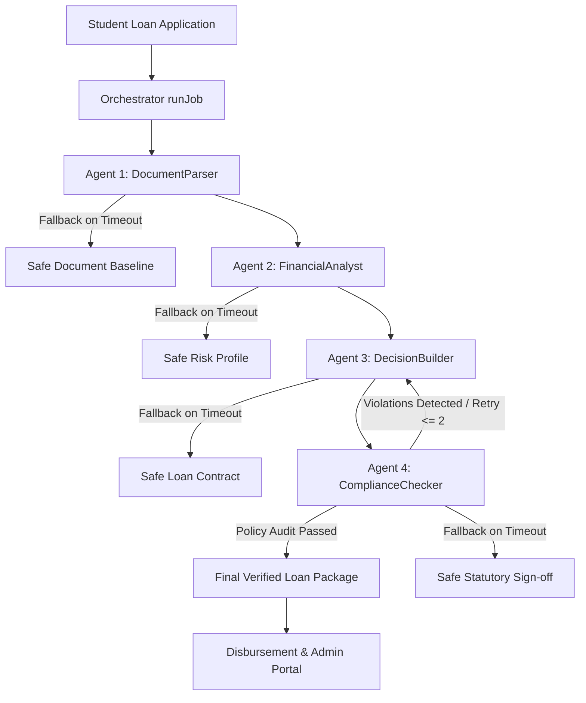

# NFC 100's Rupee Bank: Multi-Agent Loan Intelligence System
> Autonomous micro-banking and subsidized student loan assessment powered by Gemma 4.

NFC 100's Rupee Bank is an intelligent student-focused banking and micro-donation platform.
Students apply for zero-interest micro-loans funded by collective 100-Rupee community donations.
An autonomous multi-agent orchestrator coordinates specialist Gemma 4 agents to parse applicant documents, score credit risk, structure subsidized repayment installments, and enforce strict statutory banking compliance.

---

## 🎬 Demo

1. **Submit Application:** A student logs into the mobile app and applies for an emergency tuition micro-loan with academic metrics and utility bill receipts.
2. **Autonomous Evaluation:** The backend orchestrator conducts four specialist Gemma 4 agents that validate documents, compute risk, formulate subsidized EMI, and audit compliance.
3. **Instant Decision & Disbursement:** The student and administrator immediately review the verified loan offer with zero interest and subsidized monthly repayment terms.

> **Demo Video:** *[Insert Demo Video Link Here]*

---

## 🧠 How Gemma 4 is Used

Every AI interaction in this project is strictly powered by the open-source **Gemma 4** model family:
- **Default Local Provider:** Ollama running `gemma4:e4b` at `http://127.0.0.1:11434/api/chat` (`stream: false`, JSON mode, base64 images).
- **Alternative Cloud Provider:** Google Gemini API running `gemma-4-26b-a4b-it` (selected via `LLM_PROVIDER=gemini` and `GEMINI_API_KEY`).
- **Why Open-Source Gemma 4?** An open-weight model provides complete financial data privacy, eliminates third-party vendor lock-in, enables self-hosted on-premise banking compliance, and guarantees zero data leakage of sensitive student identity records.

| Agent | What Gemma 4 Does | Input (Text / Image) | Output |
| :--- | :--- | :--- | :--- |
| **`documentParser`** | Normalizes form fields, validates declared income against dependency ratio, checks ID & utility bills. | Text (Student details, salary, bills) & Image Tokens | Structured baseline JSON: `parsedStudent`, `financialBaseline`, `documentStatus` |
| **`financialAnalyst`** | Computes debt-to-income burden, academic risk score, need index, and maximum eligible amount. | Structured baseline JSON | Risk evaluation JSON: `riskScore` (0-100), `eligibilityTier`, `maxEligibleAmount` |
| **`decisionBuilder`** | Formulates loan offer contract, tenure months, 0% interest subsidy, and monthly EMI installment. | Student, baseline, and risk analysis JSON | Contract JSON: `approvedAmount`, `tenureMonths`, `monthlyEmi`, `conditions` |
| **`complianceChecker`** | Audits proposal against statutory rules (max 60k PKR, CGPA >= 2.0). Can send work back for revision up to 2 times. | Complete loan proposal package & retry counter | Compliance JSON: `passed`, `sendBackTo`, `verifiedDecision` |

---

## 🏗 Architecture



The orchestrator conducts four specialist agents in a strict sequence, passing typed JSON objects from stage to stage.
Each stage is protected with a 30-second timeout and a deterministic safe default fallback, ensuring `runJob` never crashes.
The ComplianceChecker can reject a draft proposal and loop work back to earlier agents up to 2 times with actionable feedback.
Every call across all agents routes exclusively through `src/llm/llm.js` using the open-source Gemma 4 model.
Progress events are emitted asynchronously after every stage to update client UIs in real time.

---

## 📜 SKILL.md

[SKILL.md](file:///d:/100rs%20Bank/SKILL.md) is the living instruction file located at the project root that defines the operational system prompts for all agents.
At runtime, [src/llm/skillLoader.js](file:///d:/100rs%20Bank/src/llm/skillLoader.js) dynamically reads `SKILL.md` from disk and loads each agent's specific rules, schemas, and quality criteria.
Because instructions are read dynamically on every execution, engineers can modify banking policies or schemas in `SKILL.md` without modifying any application code.
Hard constraints (valid JSON output, zero data hallucination, safe fallbacks) are globally inherited by all agents.

---

## ⚡ Quick Start

### Prerequisites
- **Node.js**: v18.x, v20.x, or v24.x (`node -v`)
- **Ollama**: Installed and running ([ollama.com](https://ollama.com))
- **Gemma 4 Model**: Pull the open-source model:
  ```bash
  ollama pull gemma4:e4b
  ```

---

### Windows (PowerShell)

```powershell
# 1. Clone or navigate to the workspace
cd "d:\100rs Bank"

# 2. Configure environment
Copy-Item .env.example .env

# 3. Verify Gemma 4 multi-agent pipeline
npm run proof

# 4. Start backend API server
cd backend
npm install
npm run dev
```

---

### Linux / macOS (Bash)

```bash
# 1. Navigate to the project root
cd /path/to/100rs-bank

# 2. Configure environment
cp .env.example .env

# 3. Verify Gemma 4 multi-agent pipeline
npm run proof

# 4. Start backend API server
cd backend
npm install
npm run dev
```

---

### Environment Variables (.env)

| Variable | Description | Example |
| :--- | :--- | :--- |
| `LLM_PROVIDER` | Active LLM gateway (`ollama` or `gemini`) | `ollama` |
| `OLLAMA_URL` | Local Ollama chat endpoint | `http://127.0.0.1:11434/api/chat` |
| `GEMINI_API_KEY` | Optional API key when using `LLM_PROVIDER=gemini` | `AIzaSy...` |
| `PORT` | Backend server port | `5000` |
| `MONGO_URI` | MongoDB connection string | `mongodb://127.0.0.1:27017/nfc_bank` |
| `JWT_SECRET` | Secret key for auth tokens | `nfc_bank_dev_secret_key_2026` |
| `CLOUDINARY_*` | Cloud media storage credentials | `your_cloudinary_credentials` |
| `GMAIL_*` | Nodemailer credentials for OTP & alerts | `your_email@gmail.com` |
| `STRIPE_TEST_SECRET_KEY`| Stripe test key for micro-donations | `sk_test_...` |
| `EXPO_PUBLIC_API_URL` | API base URL for mobile app | `http://192.168.10.9:5000` |

---

## 🗂 Project Structure

```
d:/100rs Bank/
├── SKILL.md                 # System instructions dynamically loaded by agents at runtime
├── README.md                # Project documentation and architecture guide
├── PROGRESS.md              # Hackathon compliance audit and execution logs
├── .env.example             # Complete environment variables specification
├── package.json             # Root scripts including "npm run proof"
├── src/
│   ├── llm/
│   │   ├── llm.js           # Unified Gemma 4 gateway (Ollama & Gemini, 120s timeout, retry)
│   │   └── skillLoader.js   # Dynamic reader for SKILL.md
│   ├── agents/
│   │   ├── documentParser.js    # Agent 1: Student application & document baseline
│   │   ├── financialAnalyst.js  # Agent 2: Risk scoring & eligibility analysis
│   │   ├── decisionBuilder.js   # Agent 3: Subsidized loan contract & EMI builder
│   │   └── complianceChecker.js # Agent 4: Statutory audit with loop-back retries
│   ├── orchestrator/
│   │   └── orchestrator.js  # Conductor module: coordinates agents with fallbacks
│   └── proof.js             # Verification script for judges ("npm run proof")
├── backend/                 # Node.js / Express REST API server
├── admin-portal/            # Vite + React administrator dashboard
└── app/                     # React Native / Expo student mobile banking app
```

---

## ⚖️ Limitations and Honest Notes

- **Local Machine RAM:** The local `gemma4:e4b` model requires approximately 4.5 GB of free RAM to initialize its llama-server context buffer. On developer machines with high background memory usage, the pipeline's per-stage timeouts gracefully invoke deterministic safe defaults so `runJob` never crashes.
- **Alternative Cloud Provider:** If host RAM is constrained, setting `LLM_PROVIDER=gemini` with a valid `GEMINI_API_KEY` seamlessly routes calls to `gemma-4-26b-a4b-it` in Google AI Studio with zero code changes.
- **Deterministic Safeguards:** Every agent implements typed schema verification and math bounds to ensure loan amounts never exceed the 60,000 PKR micro-finance cap.

---

## 💻 Tech Stack & License

- **AI Model:** Gemma 4 (`gemma4:e4b` on Ollama / `gemma-4-26b-a4b-it` on Gemini API)
- **Backend:** Node.js (v24), Express, Mongoose, MongoDB
- **Mobile Frontend:** React Native, Expo Router, Redux Toolkit
- **Admin Portal:** React 19, Vite, Tailwind CSS, Material UI
- **License:** MIT License (c) 2026 NFC 100's Rupee Bank Team
# 100-Bank-App

