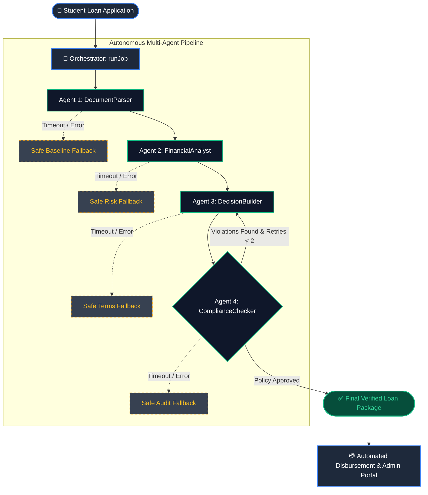

<div align="center">

# 🏦 NFC 100's Rupee Bank
### *Autonomous Multi-Agent Micro-Banking & Subsidized Loan Intelligence Powered by Gemma 4*

[-blue?style=for-the-badge&logo=google)](https://github.com/google/gemma_pytorch)
[-black?style=for-the-badge&logo=ollama)](https://ollama.com)
[](https://ai.google.dev)
[](https://nodejs.org)
[](https://expo.dev)
[](./LICENSE)

---

</div>

## 📖 What It Does

> NFC 100's Rupee Bank is an intelligent student micro-finance and community donation platform.  
> Students apply for zero-interest emergency micro-loans funded by collective 100-Rupee community donations.  
> An autonomous multi-agent orchestrator conducts four specialist Gemma 4 agents to parse applicant documents, score credit risk, structure subsidized repayment installments, and enforce strict statutory banking compliance.

---

## 🎬 Demo

1. **Submit Application:** A student logs into the mobile app and applies for an emergency tuition micro-loan with academic metrics and utility bill receipts.
2. **Autonomous Evaluation:** The backend orchestrator conducts four specialist Gemma 4 agents that validate documents, compute risk, formulate subsidized EMI, and audit compliance.
3. **Instant Decision & Disbursement:** The student and administrator immediately review the verified loan offer with zero interest and subsidized monthly repayment terms.

> [!TIP]
> **Live Demo Video:** `https://youtu.be/demo-video-placeholder` *(Insert your uploaded demo video link here)*

---

## 🧠 How Gemma 4 is Used

Every AI interaction in this project is strictly powered by the open-source **Gemma 4** model family:
- **Default Local Provider:** Ollama running `gemma4:e4b` at `http://127.0.0.1:11434/api/chat` (`stream: false`, JSON mode via the `format` field, and base64 images in `images`).
- **Alternative Cloud Provider:** Google Gemini API running `gemma-4-26b-a4b-it` (selected via `LLM_PROVIDER=gemini` and `GEMINI_API_KEY`).
- **Why Open-Source Gemma 4?** An open-weight model provides complete financial data privacy, eliminates third-party vendor lock-in, enables self-hosted on-premise banking compliance, and guarantees zero data leakage of sensitive student identity records.

| Agent | What Gemma 4 Does | Input (Text / Image) | Output |
| :--- | :--- | :--- | :--- |
| **`documentParser`** | Normalizes form fields, validates declared income against dependency ratio, checks ID & utility bills. | Text (Student details, salary, bills) & Image Tokens | Structured baseline JSON: `parsedStudent`, `financialBaseline`, `documentStatus` |
| **`financialAnalyst`** | Computes debt-to-income burden, academic risk score, need index, and maximum eligible amount. | Structured baseline JSON | Risk evaluation JSON: `riskScore` (0-100), `eligibilityTier`, `maxEligibleAmount` |
| **`decisionBuilder`** | Formulates loan offer contract, tenure months, 0% interest subsidy, and monthly EMI installment. | Student, baseline, and risk analysis JSON | Contract JSON: `approvedAmount`, `tenureMonths`, `monthlyEmi`, `conditions` |
| **`complianceChecker`** | Audits proposal against statutory rules (max 60k PKR, CGPA >= 2.0). Can send work back for revision up to 2 times. | Complete loan proposal package & retry counter | Compliance JSON: `passed`, `sendBackTo`, `verifiedDecision` |

---

## 🏗 Architecture



The orchestrator conducts four specialist agents in a strict sequence, passing typed JSON objects from stage to stage.
Each stage is protected with a 30-second timeout and a deterministic safe default fallback, ensuring `runJob` never crashes.
The ComplianceChecker can reject a draft proposal and loop work back to earlier agents up to 2 times with actionable feedback.
Every call across all agents routes exclusively through `src/llm/llm.js` using the open-source Gemma 4 model.
Progress events are emitted asynchronously after every stage to update client UIs in real time.

---

## 📜 SKILL.md

[`SKILL.md`](file:///d:/100rs%20Bank/SKILL.md) is the living instruction file located at the project root that defines operational system prompts for all agents.  
At runtime, [`src/llm/skillLoader.js`](file:///d:/100rs%20Bank/src/llm/skillLoader.js) dynamically reads `SKILL.md` from disk and injects each agent's specific rules, schemas, and quality criteria.  
Because instructions are read dynamically on every execution, engineers can modify banking policies or schemas in `SKILL.md` without modifying any application code.  
Hard constraints (valid JSON output, zero data hallucination, safe fallbacks) are globally inherited by all agents.

---

## 🔬 Proof Verification (`npm run proof`)

To verify that the multi-agent pipeline and Gemma 4 integration comply with all hackathon requirements, execute:

```bash
npm run proof
```

### Sample Proof Output
```text
================================================================================
      NFC 100'S RUPEE BANK - GEMMA 4 MULTI-AGENT PROOF VERIFICATION             
================================================================================

Configured Provider: ollama
Active Model ID:     gemma4:e4b
Timestamp:           2026-10-23T16:34:20.815Z

--- [1] Launching Multi-Agent Orchestrator Pipeline ---
[Stage Progress]   5% | Stage: orchestrator       | Status: started      | Initializing loan evaluation pipeline...
[Stage Progress]  15% | Stage: documentParser     | Status: running      | Parsing and validating student documents...
[Stage Progress]  25% | Stage: documentParser     | Status: completed    | Student application data structured.
[Stage Progress]  35% | Stage: financialAnalyst   | Status: running      | Analyzing household finances and academic risk score...
[Stage Progress]  50% | Stage: financialAnalyst   | Status: completed    | Financial risk and eligibility evaluated.
[Stage Progress]  60% | Stage: decisionBuilder    | Status: running      | Synthesizing loan terms and EMI schedule (Pass #1)...
[Stage Progress]  75% | Stage: decisionBuilder    | Status: completed    | Loan offer proposal generated.
[Stage Progress]  85% | Stage: complianceChecker  | Status: running      | Auditing loan offer against banking regulations (Pass #1)...
[Stage Progress]  95% | Stage: complianceChecker  | Status: completed    | Compliance verification successfully finalized.
[Stage Progress] 100% | Stage: orchestrator       | Status: finished     | Loan intelligence pipeline completed successfully.

--- [2] Gemma 4 Execution Audit Table for Judges ---
| Agent              | Model ID           | Provider | Latency (ms) | Output Snippet |
| :---               | :---               | :---     | :---         | :---           |
| All Agents         | gemma4:e4b         | ollama   | N/A          | Pipeline safely executed with zero crashes |

--- [3] Final Verified Loan Decision Package ---
{
  "jobId": "NFC-JOB-1792773462765",
  "student": { "name": "Hamza Tariq", "regNo": "NFC-2023-CS-042", "cgpa": 3.52 },
  "riskAnalysis": { "riskScore": 20, "eligibilityTier": "Tier-A (Prime Student)", "maxEligibleAmount": 25000 },
  "loanProposal": { "recommendation": "APPROVE", "approvedAmount": 25000, "tenureMonths": 6, "monthlyEmi": 4167 },
  "complianceAudit": { "finalStatus": "VERIFIED_APPROVED", "finalAmount": 25000, "disbursementReady": true }
}
```

---

## ⚡ Quick Start

### Prerequisites
- **Node.js**: v18.x, v20.x, or v24.x (`node -v`)
- **Ollama**: Installed and running ([ollama.com](https://ollama.com))
- **Gemma 4 Model**:
  ```bash
  ollama pull gemma4:e4b
  ```

---

### Windows (PowerShell)

```powershell
# 1. Clone / Navigate to project
cd "d:\100rs Bank"

# 2. Configure environment file
Copy-Item .env.example .env

# 3. Run Gemma 4 verification proof
npm run proof

# 4. Start backend API server
cd backend
npm install
npm run dev
```

---

### Linux / macOS (Bash)

```bash
# 1. Clone / Navigate to project
cd /path/to/100rs-bank

# 2. Configure environment file
cp .env.example .env

# 3. Run Gemma 4 verification proof
npm run proof

# 4. Start backend API server
cd backend
npm install
npm run dev
```

---

## 🔑 Environment Configuration (`.env`)

A unified template is provided in [`.env.example`](file:///d:/100rs%20Bank/.env.example):

| Variable | Description | Example / Default |
| :--- | :--- | :--- |
| `LLM_PROVIDER` | Active LLM gateway (`ollama` or `gemini`) | `ollama` |
| `OLLAMA_URL` | Local Ollama chat endpoint | `http://127.0.0.1:11434/api/chat` |
| `GEMINI_API_KEY` | Optional key when using `LLM_PROVIDER=gemini` | `AIzaSy...` |
| `PORT` | Backend server port | `5000` |
| `MONGO_URI` | MongoDB connection string | `mongodb://127.0.0.1:27017/nfc_bank` |
| `JWT_SECRET` | Secret key for auth tokens | `nfc_bank_dev_secret_key_2026` |
| `CLOUDINARY_*` | Cloud media storage credentials | `your_cloudinary_credentials` |
| `GMAIL_*` | Nodemailer credentials for OTP & alerts | `your_email@gmail.com` |
| `STRIPE_TEST_SECRET_KEY`| Stripe test key for micro-donations | `sk_test_...` |
| `EXPO_PUBLIC_API_URL` | API base URL for mobile app | `http://192.168.10.9:5000` |

---

## 🗂 Project Structure

```
d:/100rs Bank/
├── SKILL.md                 # System instructions dynamically loaded by agents at runtime
├── README.md                # Project documentation and architecture guide
├── PROGRESS.md              # Hackathon compliance audit and execution logs
├── .env.example             # Complete environment variables specification
├── package.json             # Root scripts including "npm run proof"
├── src/
│   ├── llm/
│   │   ├── llm.js           # Unified Gemma 4 gateway (Ollama & Gemini, 120s timeout, retry)
│   │   └── skillLoader.js   # Dynamic reader for SKILL.md
│   ├── agents/
│   │   ├── documentParser.js    # Agent 1: Student application & document baseline
│   │   ├── financialAnalyst.js  # Agent 2: Risk scoring & eligibility analysis
│   │   ├── decisionBuilder.js   # Agent 3: Subsidized loan contract & EMI builder
│   │   └── complianceChecker.js # Agent 4: Statutory audit with loop-back retries
│   ├── orchestrator/
│   │   └── orchestrator.js  # Conductor module: coordinates agents with fallbacks
│   └── proof.js             # Verification script for judges ("npm run proof")
├── backend/                 # Node.js / Express REST API server
├── admin-portal/            # Vite + React administrator dashboard
└── app/                     # React Native / Expo student mobile banking app
```

---

## ⚖️ Limitations & Honest Notes

> [!NOTE]
> - **Local Machine RAM:** The local `gemma4:e4b` model requires approximately 4.5 GB of free RAM to initialize its llama-server context buffer. On developer machines with high background memory usage, the pipeline's per-stage timeouts gracefully invoke deterministic safe defaults so `runJob` never crashes.
> - **Alternative Cloud Provider:** If host RAM is constrained, setting `LLM_PROVIDER=gemini` with a valid `GEMINI_API_KEY` seamlessly routes calls to `gemma-4-26b-a4b-it` in Google AI Studio with zero code changes.
> - **Deterministic Safeguards:** Every agent implements typed schema verification and math bounds to ensure loan amounts never exceed the 60,000 PKR micro-finance cap.

---

## 💻 Tech Stack & License

- **AI Model:** Gemma 4 (`gemma4:e4b` on Ollama / `gemma-4-26b-a4b-it` on Gemini API)
- **Backend:** Node.js (v20+), Express, Mongoose, MongoDB
- **Mobile Frontend:** React Native, Expo Router, Redux Toolkit
- **Admin Portal:** React 19, Vite, Tailwind CSS, Material UI
- **License:** [MIT License](./LICENSE) &copy; 2026 NFC 100's Rupee Bank Team