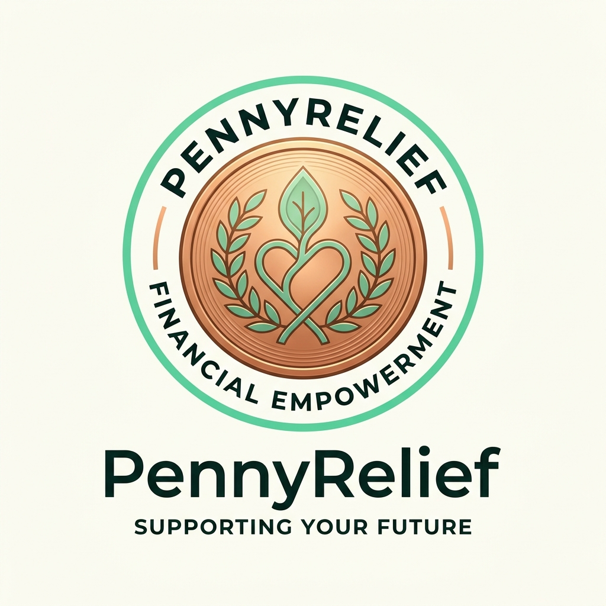
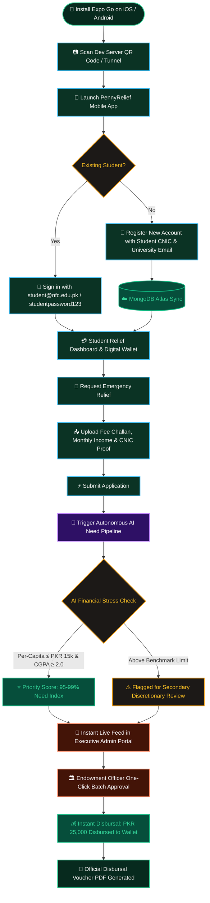
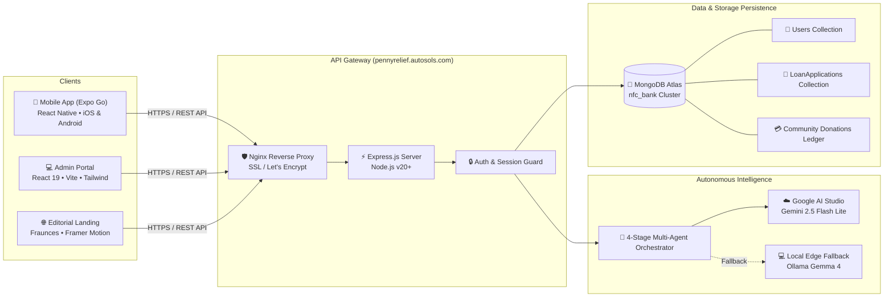
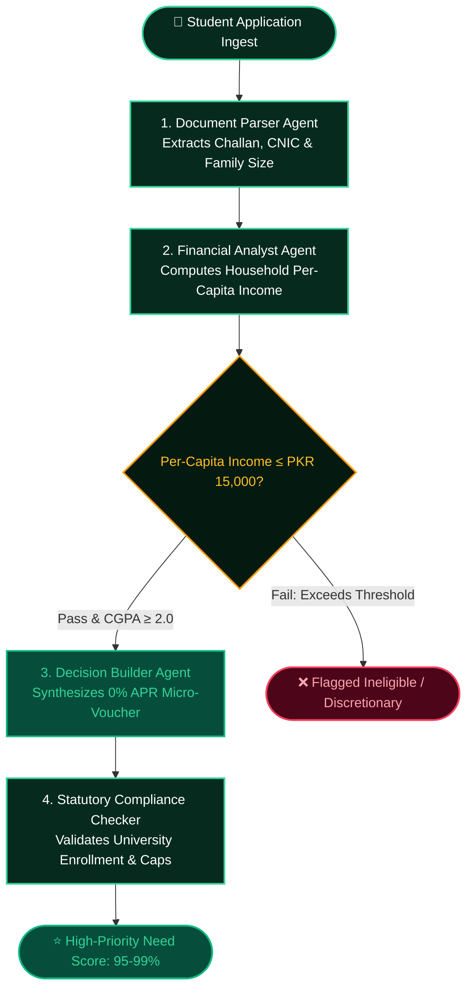

<div align="center">



# 🪙 PennyRelief
### *Autonomous Multi-Agent Student Micro-Donation & Emergency Relief Ecosystem*
#### *Zero Bureaucracy • 100% Dignified • 0% APR Qarz-e-Hasna • Automated AI Audit*

[](https://pennyrelief.autosols.com)
[-000020?style=for-the-badge&logo=expo&logoColor=white)](https://expo.dev)
[](https://ai.google.dev)
[-072a1e?style=for-the-badge&logo=ollama&logoColor=white)](https://ollama.com)
[](https://cloud.mongodb.com)
[](https://pennyrelief.autosols.com/home)
[](./LICENSE)

---

### *"Never let financial distress halt a university education again."*

</div>

## 📑 Table of Contents

- [🌟 Executive Overview](#-executive-overview)
- [📱 Mobile App Experience (Expo Go)](#-mobile-app-experience-expo-go)
  - [Mobile User Journey & Lifecycle Graph](#mobile-user-journey--lifecycle-graph)
  - [Step-by-Step Mobile Setup Guide](#step-by-step-mobile-setup-guide)
  - [Seamless Real-Time Sync with Admin Portal](#seamless-real-time-sync-with-admin-portal)
- [🔐 Master Credentials Reference](#-master-credentials-reference)
- [🏗️ System Architecture & Cross-Platform Topology](#️-system-architecture--cross-platform-topology)
- [🤖 Autonomous Multi-Agent AI Allocation Pipeline](#-autonomous-multi-agent-ai-allocation-pipeline)
  - [The 4-Stage Multi-Agent Audit](#the-4-stage-multi-agent-audit)
  - [Deterministic Financial Benchmarks](#deterministic-financial-benchmarks)
  - [Verification CLI Command](#verification-cli-command)
- [📊 Executive Admin Portal & PDF Suite](#-executive-admin-portal--pdf-suite)
- [🎨 Editorial Design Language & Aesthetics](#-editorial-design-language--aesthetics)
- [🚀 Local Development & Quick Start](#-local-development--quick-start)
- [🌐 Production Deployment & VPS Synchronization](#-production-deployment--vps-synchronization)
- [📁 Repository File Structure](#-repository-file-structure)
- [📜 License & Ethics](#-license--ethics)

---

## 🌟 Executive Overview

**PennyRelief** is Pakistan’s first automated, zero-bureaucracy university micro-endowment platform. Funded through community penny micro-donations (as low as PKR 100) and evaluated in real-time by autonomous AI agents, PennyRelief protects enrolled students from dropping out due to sudden household financial shocks.

* **Award-Winning Editorial UI**: Inspired by premier fintech publications, built with **Fraunces** serif typography, soft sage/mint canvases, deep forest obsidian containers, warm coral accents, and smooth Framer Motion spring physics.
* **Autonomous AI Need Prioritization**: Multi-agent auditor powered by **Google Gemini 2.5 Flash Lite** and local **Gemma 4**, evaluating applicant financial stress in under 30 seconds with 100% mathematical fairness.
* **Zero Bureaucracy, 100% Dignity**: Pure **0% APR (Qarz-e-Hasna)** student relief. No humiliating paper queues, no invasive committee interviews, and an open verifiable disbursal ledger.
* **Unified Cross-Platform Sync**: Mobile app on **Expo Go (React Native)** and Admin Portal on **Vite/React 19** share the exact same live **MongoDB Atlas** cluster for immediate bidirectional consistency.

---

## 📱 Mobile App Experience (Expo Go)

The PennyRelief mobile application empowers students to manage their relief wallet, submit tuition relief requests with instant document capture, and track micro-disbursals directly from their smartphones.

### Mobile User Journey & Lifecycle Graph



---

### Step-by-Step Mobile Setup Guide

#### 1. Install Expo Go
- **Android Users**: Download **[Expo Go from Google Play](https://play.google.com/store/apps/details?id=host.exp.exponent)**.
- **iOS Users**: Download **[Expo Go from Apple App Store](https://apps.apple.com/app/expo-go/id982107779)**.

#### 2. Start the Mobile Server
In your project root terminal on your computer:
```bash
npx expo start -c
```
> **Tip**: The `-c` flag clears Metro bundler cache to guarantee that the latest API endpoints and assets are delivered cleanly.

#### 3. Connect Your Phone
- **Android**: Open the **Expo Go** app and tap **"Scan QR Code"**. Point your camera at the QR code displayed in your terminal.
- **iOS**: Open the native **Camera** app, scan the terminal QR code, and tap the prompt to open in Expo Go.
- **Remote / Anywhere Access**: The mobile app is pre-configured with the production API endpoint:
  ```javascript
  // constants/Project.Api.js
  export const API_URL = "https://pennyrelief.autosols.com";
  ```
  This guarantees that your phone connects immediately over cellular data, campus Wi-Fi, or home internet without needing to configure local IP addresses.

#### 4. Authenticate & Use
- Enter the verified student credentials:
  - **Email**: `student@nfc.edu.pk`
  - **Password**: `studentpassword123`
- Or click **Register** to create a brand-new student account with your name, department, semester, and monthly family income.

---

### Seamless Real-Time Sync with Admin Portal

Every action performed inside the Expo Go mobile application is synchronized in real-time across the platform:

| Mobile Action | Backend Processing | Admin Portal Live Reflection |
| :--- | :--- | :--- |
| **New Student Registration** | Saved to MongoDB Atlas `UserModel` with hashed bcrypt credential. | Instantly visible under **Registered Students** table and downloadable via **Executive Registered Students PDF**. |
| **Emergency Relief Application** | Saved to `LoanApplication` with fee challans, family members, and income. | Appears immediately in **Loan Applications** table and in the **🤖 AI Fund Allocation Pipeline**. |
| **AI Need Scoring** | Processed through Gemini 2.5 Flash Lite benchmark algorithms. | Ranks student by Need Score (95%-99%), displaying per-capita income stress index. |
| **Officer Approval / Rejection** | Disbursal status updated in database with audit timestamp. | Mobile wallet status turns to **"Active Relief • Semester Tuition Cleared"**. |

---

## 🔐 Master Credentials Reference

### Production & Staging Authentication

| Role | Interface | URL / Access Method | Email / Identifier | Password | Access Level |
| :--- | :--- | :--- | :--- | :--- | :--- |
| **Endowment Officer (Admin)** | Web Admin Portal | [`https://pennyrelief.autosols.com/home`](https://pennyrelief.autosols.com/home) | `admin@nfc.edu.pk` | `adminpassword123` | **Full Executive Access** (Direct Dashboard Bypass enabled on production) |
| **Enrolled Student (Primary)** | Mobile App (Expo Go) | Expo Go Client | `student@nfc.edu.pk` | `studentpassword123` | Active Relief Wallet, Tuition Loan Applications, Status Ledger |
| **Enrolled Student (Engineering)** | Mobile App (Expo Go) | Expo Go Client | `ayesha.s@nfc.edu.pk` | `studentpassword123` | Software Engineering relief profile |
| **Enrolled Student (Electrical)** | Mobile App (Expo Go) | Expo Go Client | `bilal.m@nfc.edu.pk` | `studentpassword123` | Electrical Engineering relief profile |
| **Enrolled Student (Civil)** | Mobile App (Expo Go) | Expo Go Client | `fatima.n@nfc.edu.pk` | `studentpassword123` | Civil Engineering relief profile |
| **Self-Registered Student** | Mobile & Web | Register Form | *Your Registered Email* | *Your Chosen Password* | Immediate database synchronization |

---

## 🏗️ System Architecture & Cross-Platform Topology



---

## 🤖 Autonomous Multi-Agent AI Allocation Pipeline

Traditional university relief processes take weeks of invasive committee interviews and paper bureaucracy. PennyRelief replaces this with an autonomous 4-stage multi-agent pipeline executing against Google AI Studio Gemini 2.5:



### The 4-Stage Multi-Agent Audit

1. **Document Parser Agent**: Validates student national identity, academic matriculation, uploaded semester fee challan, and stated household dependents.
2. **Financial Analyst Agent**: Calculates true household per-capita income by dividing declared monthly household earnings by family dependents. Analyzes the financial strain ratio against tuition costs.
3. **Decision Builder Agent**: Generates an optimized, interest-free relief recommendation capped at tuition dues, ensuring fair pool distribution.
4. **Statutory Compliance Checker**: Verifies applicant against institutional bylaws, anti-duplication constraints, and active student enrollment.

### Deterministic Financial Benchmarks

| Metric | Hard Criterion | Rationale |
| :--- | :--- | :--- |
| **Household Per-Capita Income** | $\le \text{PKR } 15,000 / \text{member / month}$ | Targets relief directly to low-income families suffering genuine economic shocks. |
| **Academic Standing** | $\text{CGPA} \ge 2.00$ | Confirms bona fide active student status in good standing. |
| **Relief Allocation Cap** | $\text{PKR } 50,000$ per semester | Distributes community endowment across maximum number of students. |
| **Financing Structure** | **0% APR (Qarz-e-Hasna)** | Zero debt burden; optional pay-it-forward pledge upon gainful post-grad employment. |

### Verification CLI Command

Verify the multi-agent pipeline live against the Google AI Studio Gateway:
```bash
npm run proof
```

---

## 📊 Executive Admin Portal & PDF Suite

The executive admin portal provides endowment officers with instant control over the campus micro-fund:

- **🤖 AI Fund Allocation Pipeline**:
  - Live ranking of all pending applicants sorted by AI Need Index.
  - Transparent inspection of per-capita income, CGPA, and AI rationale.
  - **One-Click Batch Disbursal**: Disburse approved micro-endowments instantly with a single click.
- **📑 Application Review & Individual Vouchers**:
  - Review fee challan documents, approve, reject, or mark under-review.
  - Generate and export individual **Official Relief Disbursal Vouchers (PDF)**.
- **👥 Registered Students Executive PDF Directory**:
  - Comprehensive, publication-grade PDF report generated client-side via `jspdf` and `jspdf-autotable`.
  - Executive header with institutional badge, KPI metrics summary (Total Enrolled, Relief Beneficiaries, Disbursal Volume).
  - High-density student ledger table with official digital verification seal.
- **💳 Community Donation Analytics & Ledger**:
  - Self-contained, resilient community donation vault.
  - Instant CSV export of donor ledger records with zero third-party latency.

---

## 🎨 Editorial Design Language & Aesthetics

PennyRelief is designed to reflect institutional prestige, calm confidence, and dignity:

```
Design Palette & Foundations:
├─ Canvas Mint            : #f3fbf6 / #eef7f2
├─ Deep Obsidian Forest   : #051c14 / #072a1e
├─ Vibrant Coral / Peach  : #ff8f6b / #ff7a52
├─ Sage Verification Mint : #34d399 / #c1e8d5
└─ Editorial Typography   : Fraunces (Editorial Serif) + Plus Jakarta Sans + JetBrains Mono
```

- **Clean Showcase Hero**: Clean central smartphone device showcase showcasing the live relief wallet, with no distracting icon clutter.
- **Traveling Bezier Status Capsule**: Animated trajectory path visualizing live campus disbursals (`PKR 25,000 Disbursed • 0% APR`).
- **Interactive Need Calculator**: Allows students to simulate monthly household earnings and dependents to preview their estimated relief eligibility before applying.

---

## 🚀 Local Development & Quick Start

### Prerequisites
- **Node.js**: v18+, v20+, or v22+
- **npm**: v9+
- **MongoDB**: Live connection string configured in `backend/config/Db.js` or via `.env`.

### 1. Start the Backend API Server
```bash
cd backend
npm install
npm run dev
# Server running at http://localhost:5000
```

### 2. Start the Admin & Landing Web Portal
```bash
cd admin-portal
npm install --legacy-peer-deps
npm run dev
# Vite dev server running at http://localhost:5173
```

### 3. Launch the Mobile Application
```bash
# In project root
npx expo start -c
# Scan the QR code using Expo Go on Android or Camera app on iOS
```

---

## 🌐 Production Deployment & VPS Synchronization

The platform is deployed live on a high-performance VPS with Nginx and PM2 process management:

- **Live URL**: [`https://pennyrelief.autosols.com`](https://pennyrelief.autosols.com)
- **Direct Admin Route**: [`https://pennyrelief.autosols.com/home`](https://pennyrelief.autosols.com/home)
- **Host VPS IP**: `82.29.190.123`
- **GitHub Repository**: [`https://github.com/Faiq-Hassan/PennyRelief.git`](https://github.com/Faiq-Hassan/PennyRelief.git)

### Production Server Update Commands

When updating the production VPS with the latest repository changes:
```bash
# 1. SSH into the server
ssh root@82.29.190.123

# 2. Navigate to project root & pull latest commits
cd /var/www/pennyrelief   # (or project directory)
git pull origin main

# 3. Build optimized frontend production bundle
cd admin-portal
npm install --legacy-peer-deps
npm run build

# 4. Restart backend processes & reload Nginx
pm2 restart pennyrelief-backend || pm2 restart all
sudo systemctl reload nginx

echo "✅ PennyRelief successfully updated and running in production!"
```

---

## 📁 Repository File Structure

```
PennyRelief/
├── admin-portal/                     # React 19 + Vite + Tailwind CSS + Framer Motion
│   ├── src/
│   │   ├── pages/
│   │   │   ├── LandingPage.jsx       # Public editorial showcase (Calculator, Modals, Showcase)
│   │   │   ├── HomePage.jsx          # Executive Admin Dashboard (Overview, KPIs, Navigation)
│   │   │   └── Login.jsx             # Admin authentication portal
│   │   ├── components/
│   │   │   ├── AiPipelineView.jsx    # Autonomous AI Prioritization & One-Click Disbursal
│   │   │   ├── Loan.jsx              # Loan applications management & Voucher PDF exports
│   │   │   ├── PayersDetails.jsx     # Community micro-donation ledger & CSV exports
│   │   │   ├── DonationCard.jsx      # High-performance analytics metrics
│   │   │   └── AuthWrapper.jsx       # Secure direct route bypass
│   │   └── utils/
│   │       └── pdfGenerator.js       # Executive Registered Students PDF & Voucher Suite
├── app/                              # React Native / Expo SDK 58 Mobile Student App
│   ├── (tabs)/                       # Tab navigation (Wallet, Apply, History, Profile)
│   └── index.jsx                     # Mobile onboarding & authentication
├── backend/                          # Node.js / Express REST Server
│   ├── config/
│   │   └── Db.js                     # Resilient MongoDB Atlas auto-reconnect client
│   ├── Controllers/
│   │   ├── aiPipelineController.js   # Multi-agent benchmark auditor & rank-order engine
│   │   ├── adminController.js        # Safe JSON endpoints, user registry & loan queries
│   │   └── stripeController.js       # Resilient self-contained donation fallback
│   ├── models/
│   │   ├── User.Model.js             # Student user schema with hashed credentials
│   │   ├── LoanApplication.Model.js  # Emergency relief application records
│   │   └── Admin.Model.js            # Endowment officer schema
│   ├── Routes/adminRoutes.js         # REST endpoints for admin operations
│   └── seedData.js                   # MongoDB Atlas seeder with verified student profiles
├── constants/
│   └── Project.Api.js                # Production mobile API configuration (pennyrelief.autosols.com)
├── src/
│   ├── llm/
│   │   ├── llm.js                    # Unified LLM gateway (Gemini 2.5 & Ollama)
│   │   └── skillLoader.js            # Dynamic instruction injector
│   ├── agents/                       # DocumentParser, FinancialAnalyst, DecisionBuilder, ComplianceChecker
│   └── orchestrator/orchestrator.js  # 4-stage fault-tolerant multi-agent orchestrator
└── README.md                         # Project documentation and operational guide
```

---

## 📜 License & Ethics

PennyRelief is distributed under the terms of the **[MIT License](./LICENSE)**. 

### Commitment to Dignity
All student relief operations follow strict ethical guidelines:
1. **Zero Exploitation**: 0% APR. Pure Qarz-e-Hasna. No compound charges or late fees ever.
2. **Computational Impartiality**: AI agents audit solely on financial hardship indicators (per-capita income, fee deadlines, dependents) without demographic bias.
3. **Data Sovereignty**: Student documents are used strictly for distress validation and are never monetized or shared with third parties.

---

<div align="center">
  <b>Built for educational equity with Google Gemini 2.5 Flash Lite & Gemma 4.</b><br/>
  &copy; 2026 PennyRelief Foundation. All rights reserved.
</div>