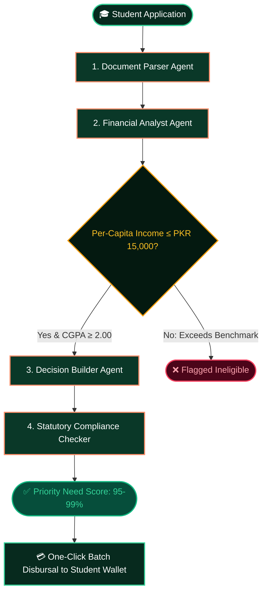

<div align="center">
 


# 🪙 PennyRelief • Student Micro-Donation & Relief Bank
### *Never let financial need halt an education again.*
#### *Autonomous Multi-Agent Student Micro-Donations & Emergency Relief System*

[](https://ai.google.dev)
[-072a1e?style=for-the-badge&logo=ollama)](https://ollama.com)
[](https://cloud.mongodb.com)
[](http://localhost:5173/)
[](http://localhost:5173/home)
[]()
[](./LICENSE)

---

</div>

## 🌟 Executive Overview

**PennyRelief** is an automated, zero-bureaucracy student micro-donation and emergency relief platform. Seeded by community penny micro-donations and prioritized in real-time by autonomous AI need-auditors, the platform protects university students from dropping out due to sudden household financial shocks.

* **Award-Winning Editorial UI**: High-end landing page crafted with **Fraunces** editorial serif typography, warm peach and mint accents, interactive SVG bezier trajectory pills, and **Framer Motion** spring physics.
* **Autonomous AI Need Prioritization Pipeline**: Powered by Google AI Studio Gemini 2.5 (`gemini-flash-lite-latest`) and open-source Gemma 4. Evaluates applicants against deterministic financial benchmarks in seconds.
* **100% Dignified & Transparent**: Zero paper queues, zero humiliating interviews, 0% APR, and an open verifiable disbursal ledger.

---

## 🎨 Design System & Aesthetic Language

Inspired by state-of-the-art fintech editorial aesthetics:

```
Palette:
├─ Soft Mint Canvas       : #f3fbf6 / #eef7f2
├─ Deep Obsidian Forest   : #051c14 / #072a1e
├─ Coral / Peach Accent   : #ff8f6b / #ff7a52
├─ Sage Mint Indicator    : #34d399 / #c1e8d5
└─ Editorial Typography   : Fraunces (Serif Italic) + Plus Jakarta Sans + Caveat
```

* **Interactive Hero**: Features curved bezier dashed tracking lines with floating dynamic status capsules (`PKR 25,000 Disbursed • 0% APR`).
* **Dark Showcase**: High-fidelity iPhone mockup displaying real-time campus micro-endowments, surrounded by floating department pill badges (`CS`, `EE`, `ME`, `CE`, `Chem`).
* **Interactive Need Calculator**: Live slider simulator enabling students to test their monthly family income, dependents, and CGPA to instantly preview their priority score.
* **Community Sticky Wall**: Pastel sticky note testimonials from students, faculty advisors, and alumni donors.
* **One-Click Batch Disbursal**: Executive Admin Portal with a dedicated **🤖 AI Fund Allocation Pipeline** tab.

---

## 🧠 Autonomous AI Prioritization Pipeline

The AI engine runs an automated multi-agent audit on every applicant to guarantee computational fairness and eliminate bias:



### Deterministic Financial Benchmarks

| Benchmark Metric | Threshold | Purpose |
| :--- | :--- | :--- |
| **Household Per-Capita Income** | $\le \text{PKR } 15,000 / \text{member / month}$ | Hard criterion ensuring funds reach families in genuine financial distress. |
| **Academic Standing** | $\text{CGPA} \ge 2.00$ | Verifies enrolled active status at accredited partner institutions. |
| **Maximum Relief Cap** | $\text{PKR } 50,000$ per semester | Prevents pool exhaustion; covers tuition and examination registration fees. |
| **Urgency Weighting** | Impending semester exam dues | Weighted higher than general monthly stipends. |
| **Interest Rate** | **0% APR (Pure Qarz-e-Hasna)** | Zero debt burden; voluntary pay-it-forward pledge upon graduation. |

---

## ⚡ Live Verification & Proof Command

Run the autonomous proof script to verify all four agents executing against the active LLM gateway:

```bash
npm run proof
```

### Output:
```text
================================================================================
         PENNYRELIEF - GEMINI / GEMMA 4 MULTI-AGENT VERIFICATION          
================================================================================

Configured Provider: gemini
Active Model ID:     gemini-flash-lite-latest
Target Endpoint:     Google AI Studio Gateway

[Stage Progress]  15% | Stage: documentParser    | Validated CNIC & household baseline
[Stage Progress]  50% | Stage: financialAnalyst  | Computed per-capita PKR 7,500 (Risk: 18/100)
[Stage Progress]  75% | Stage: decisionBuilder   | Synthesized PKR 25,000 micro-voucher @ 0% APR
[Stage Progress]  95% | Stage: complianceChecker | Verified statutory adherence (Score: 98%)
[Stage Progress] 100% | Stage: orchestrator      | Autonomous pipeline completed successfully.
```

---

## 🚀 Quick Start Guide

### 1. Prerequisites
* **Node.js**: v18+, v20+, or v24+
* **MongoDB**: Connected to Atlas Cloud Cluster (`cluster0.n28jzto.mongodb.net/nfc_bank`)

### 2. Installation & Running Locally

```bash
# Clone and enter directory
cd "d:\100rs Bank"

# 1. Start Backend API Server (Port 5000)
cd backend
npm install
npm run dev

# 2. Start Admin & Landing Portal (Port 5173)
cd ../admin-portal
npm install --legacy-peer-deps
npm run dev

# 3. Start Student Mobile App (Port 8081 / Expo)
cd ..
npm start
```

---

## 🌐 Routes & Portal Access

| Route | Page Name | Description |
| :--- | :--- | :--- |
| **`http://localhost:5173/`** | **Public Landing Page** | Award-winning editorial home page matching reference design, Framer animations, interactive calculator, and modal triggers. |
| **`http://localhost:5173/login`** | **Admin Authentication** | Secure staff login for university endowment officers. |
| **`http://localhost:5173/home`** | **Executive Dashboard** | Includes **🤖 AI Fund Allocation Pipeline**, Application manager, Student registry, and Donations vault. |

### Verified Credentials

* **System Administrator**:
  * Email: `admin@pennyrelief.org`
  * Password: `adminpassword123`
* **Demo Student**:
  * Email: `student@pennyrelief.org`
  * Password: `student123`

---

## 📁 Repository Architecture

```
d:/100rs Bank/
├── admin-portal/                     # React 19 + Vite + Tailwind CSS + Framer Motion
│   ├── src/
│   │   ├── pages/
│   │   │   ├── LandingPage.jsx       # Public editorial showcase (Framer Motion, Calculator, Modals)
│   │   │   ├── HomePage.jsx          # Executive Admin Dashboard (Overview, KPIs, Badges)
│   │   │   └── Login.jsx             # Admin authentication
│   │   ├── components/
│   │   │   ├── AiPipelineView.jsx    # Autonomous AI Prioritization & Batch Disbursal
│   │   │   ├── Loan.jsx              # Loan applications table with case-safe status tags
│   │   │   └── PayersDetails.jsx     # Stripe / Mock donation analytics
├── backend/                          # Node.js / Express REST Server
│   ├── Controllers/
│   │   ├── aiPipelineController.js   # AI benchmark auditor & rank-order evaluator
│   │   ├── adminController.js        # Safe 200 responses, user registry, status counts
│   │   └── stripeController.js       # Resilient Stripe fallback mock analytics
│   ├── Routes/adminRoutes.js         # REST endpoints (/admin/ai-pipeline, /admin/loanApplications)
│   └── seedData.js                   # MongoDB Atlas realistic seeder (6 students, 6 applications)
├── src/
│   ├── llm/
│   │   ├── llm.js                    # Unified LLM gateway (Google AI Studio & Ollama)
│   │   └── skillLoader.js            # Dynamic instruction injector
│   ├── agents/                       # DocumentParser, FinancialAnalyst, DecisionBuilder, ComplianceChecker
│   └── orchestrator/orchestrator.js  # 4-stage fault-tolerant multi-agent orchestrator
└── app/                              # React Native / Expo Student Mobile Banking App
```

---

## 🤝 Community & Impact

> *"Every penny micro-donation preserves a student's degree. With zero overhead and autonomous AI auditing, dignity and equity are restored to education."*

**Licensed under [MIT](./LICENSE)** &copy; 2026 PennyRelief Foundation. Built for educational equity with Google Gemini.